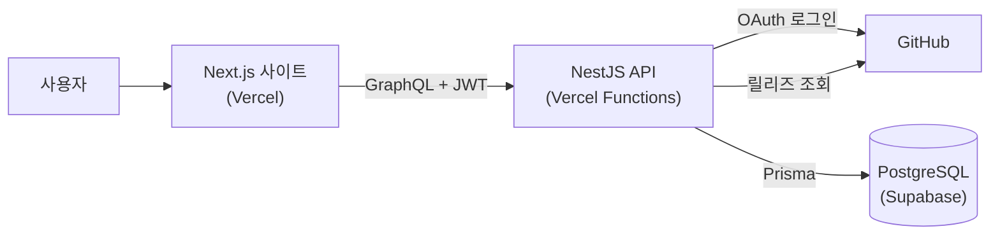

# Repository Version Checker

> 관심 있는 GitHub 레포지토리의 최신 릴리즈를 한 화면에서 모아 보는 서비스

[](https://repository-version-checker-frontend.vercel.app/)


NestJS, Next.js, GraphQL을 직접 써 보려고 만든 토이 프로젝트의 **프론트엔드**입니다.
API 서버는 [repository-version-checker-server](https://github.com/read0more/repository-version-checker-server)에 있습니다.


## 사용 방법

1. [데모 사이트](https://repository-version-checker-frontend.vercel.app/)에 들어가 **깃허브로 로그인**을 누릅니다.
2. 입력창에 레포지토리 주소를 넣습니다. 예: `https://github.com/microsoft/vscode`
3. 해당 레포의 최근 릴리즈 10개가 버전, 배포일, pre-release 여부와 함께 카드로 표시됩니다.
4. 각 버전을 누르면 GitHub 릴리즈 페이지로 이동하고, ✕ 버튼으로 목록에서 지울 수 있습니다.

## 구조



- 로그인은 서버의 GitHub OAuth를 거친 뒤 `/login?jwt=...`로 돌아오고, JWT는 `localStorage`에 저장합니다.
- 이후 모든 GraphQL 요청에는 `Authorization: Bearer <jwt>` 헤더가 붙습니다.
- 릴리즈 정보는 서버가 DB에 캐싱하고, 1분이 지난 뒤 다시 요청하면 GitHub에서 새로 받아옵니다.

## 기술 스택

| 구분 | 사용 기술 |
| --- | --- |
| 프레임워크 | Next.js 12 (Pages Router, SSG) |
| 데이터 | Apollo Client 3, `apollo client:codegen`으로 타입 생성 |
| UI | CSS Modules, Font Awesome, react-toast-notifications |
| 컴포넌트 개발 | Storybook 6 |
| 배포 | Vercel |

## 로컬 실행

Node.js 22가 필요합니다.

```bash
yarn install
```

`.env.local`을 만들고 API 서버 주소를 넣습니다.

```bash
GRAPHQL_URL=http://localhost:3000/graphql
GITHUB_LOGIN_URL=http://localhost:3000/auth/github/login
```

```bash
yarn dev        # http://localhost:3001
yarn storybook  # http://localhost:6006
```

### GraphQL 타입 다시 만들기

`apollo/schemaTypes.ts`는 서버 스키마에서 생성한 파일이고, 빌드할 때 서버에 접속하지 않도록 레포에 포함했습니다.
서버 스키마나 `apollo/` 아래 쿼리를 바꿨다면 개발 서버를 띄운 상태에서 다시 생성합니다.

```bash
GRAPHQL_URL=http://localhost:3000/graphql yarn apollo:codegen
```

## 배포

- **사이트**: `main` 브랜치에 push하면 Vercel이 자동으로 배포합니다. 환경변수는 위의 `GRAPHQL_URL`, `GITHUB_LOGIN_URL` 두 개입니다.
- **서버**: [repository-version-checker-server](https://github.com/read0more/repository-version-checker-server)를 참고하세요.

> 처음에는 서버를 Heroku 무료 플랜에 올렸는데, 무료 플랜이 없어지면서 2026년에 서버도 Vercel(Functions)과 Supabase로 옮겼습니다.
